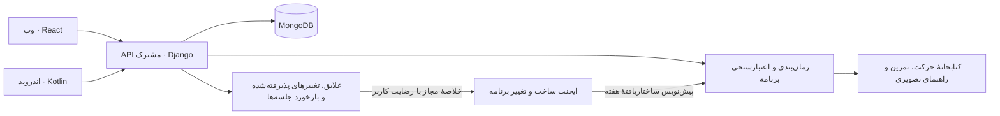

# نقشهٔ توسعهٔ ریتم

ریتم برای ورزشکار تفریحی از همان روز اول برنامه می‌سازد. کاربر یک فرم کوتاه دربارهٔ خودش، وضعیت بدنی، سابقهٔ ورزشی و علایقش پر می‌کند و ورزش اصلی را انتخاب می‌کند. ایجنت برنامهٔ هفتهٔ اول را می‌چیند و در طول هفته پیشنهاد تغییر می‌دهد. هفته‌های بعد با انتخاب‌ها و بازخوردهای کوتاه کاربر سازگارتر می‌شوند. پس از ۳۰ روز، الگوهای ماه اول در برنامهٔ بعدی وزن بیشتری می‌گیرند.

در نسخهٔ هدف، وب React و اندروید Kotlin و Jetpack Compose از API مشترک Django و Django REST Framework استفاده می‌کنند. MongoDB منبع داده است. [داستان‌های کاربر](USER_STORIES.md) · [الگوی پایگاه داده](DATABASE_PATTERN.md)

## ترتیب تحویل

- **بتای وب، P0** پس از R0 تا R4، شامل فرم روز اول، برنامهٔ ایجنت با جزئیات تصویری، تغییر برنامه با تأیید کاربر و سازگاری هفته‌به‌هفته. تولید برنامه از روز اول فعال است و هیچ فرم ثبت تمرین یا بارگذاری سابقه‌ای در مسیر کاربر وجود ندارد.
- **وب و اندروید، P0** پس از R5. کاربر همان برنامه، پیش‌نمایش تغییر و وضعیت جلسه‌ها را با یک حساب روی هر دو پلتفرم می‌بیند.
- **اتصال اختیاری، P1** پس از R6 و در صورت احراز مجوزهای لازم. مسیر پایه با فرم شروع، ترجیحات و بازخوردهای کوتاه کار می‌کند.

### R0 — قرارداد مشترک و سازگاری فنی

- **خروجی** · قرارداد OpenAPI نسخهٔ `/api/v1`، خطاهای مشترک، راه‌اندازی توسعه و CI، و داده‌های ساختگی برای فرم روز اول، برنامه، پیش‌نمایش تغییر و بازخورد. Python 3.13، Django 5.2 LTS، Django MongoDB Backend 5.2.x و MongoDB 8.0 در محیط آزمایشی قفل می‌شوند. [مستند سازگاری MongoDB](https://www.mongodb.com/docs/drivers/compatibility/?driver-language=python&python-driver-framework=django)
- **معیار عبور** · روی MongoDB آزمایشی با replica set، مهاجرت اولیه، ایجاد حساب و نشست، جداسازی دو حساب، جلوگیری از ساخت برنامهٔ تکراری و تراکنش تغییر نسخه تست می‌شوند. نمونه‌های روز اول و مرز ۳۰ روز در دو منطقهٔ زمانی قابل بازتولیدند.

### R1 — فرم روز اول و انتخاب ورزش اصلی

- **داستان‌ها** · US-01، US-02 و US-11.
- **خروجی** · پس از ورود، کاربر در چند فرم و چک‌لیست کوتاه نام نمایشی، تجربهٔ ورزشی، هدف، زمان‌های آزاد، تجهیزات، ورزش‌ها و علایقش را مشخص می‌کند. دقیقاً یک ورزش اصلی انتخاب می‌شود. اطلاعات بدنی مثل بازهٔ سنی، قد و وزن اختیاری‌اند. پیش از استفاده از ایجنت، کاربر می‌بیند چه خلاصه‌ای برای ساخت برنامه فرستاده می‌شود. رابط فارسی و راست‌به‌چپ، تاریخ شمسی را نمایش می‌دهد و API تاریخ‌ها را با قالب ISO دریافت می‌کند.
- **معیار عبور** · کاربر با حداقل اطلاعات لازم، بدون وارد کردن سابقهٔ تمرین، فرم را کامل می‌کند. رد رضایت ایجنت مسیر دریافت برنامه را مسدود نمی‌کند. دسترسی حساب دیگر، بازیابی فرم، خروجی داده و حذف حساب تست می‌شوند.

### R2 — ساخت برنامهٔ هفتهٔ اول با ایجنت

- **داستان‌ها** · US-06 و US-09. کتابخانهٔ R2.1 هم‌زمان آماده می‌شود و تکمیل آن شرط انتشار است.
- **خروجی** · با تکمیل فرم، برنامه برای هفت تاریخ تقویمی از همان روز ساخته می‌شود. عامل برنامه‌ریز از هدف، تجربه، علایق و زمان آزاد برای چیدن هفته استفاده می‌کند و ورزش اصلی را در اولویت می‌گذارد. عامل سازنده برای جلسه‌های اصلی و مکمل تمرین‌های قابل اجرا را از کتابخانه انتخاب می‌کند. Django شناسهٔ حرکت، تطابق رشته و تجهیزات، زمان‌بندی، مدت، شدت و حجم را قبل از ذخیره اعتبارسنجی می‌کند. برای جلسه‌هایی که ایجنت نمی‌سازد یا خروجی معتبر نمی‌دهد، از الگوی بازبینی‌شده استفاده می‌شود. هفتهٔ بعد با پایان برنامهٔ فعال از همان مسیر و با آخرین اطلاعات آغاز می‌شود.
- **معیار عبور** · یک حساب تازه بدون سابقه در همان روز برنامهٔ کامل می‌گیرد. برنامه با روزها، زمان و ورزش‌های انتخابی تطابق دارد. رد رضایت، خطای مدل یا خروجی خارج از حدود به برنامهٔ کامل از الگو می‌رسد. درخواست هم‌زمان یا تکراری فقط یک نسخهٔ فعال می‌سازد و بازخوانی صفحه برنامه را عوض نمی‌کند.

### R2.1 — جزئیات جلسه و راهنمای تصویری

- **داستان** · US-13. جزئیات برای ورزش اصلی و مکمل با یک قرارداد مشترک ارائه می‌شوند.
- **خروجی** · کاربر از برنامهٔ هفتگی وارد صفحهٔ جلسه می‌شود و ترتیب تمرین‌ها، هدف، مدت، شدت و معیار ثبت نتیجه را می‌بیند. جزئیات متناسب با رشته‌اند.
  - **بدنسازی، TRX و کلیستنیکس** · نام حرکت، تعداد ست، تکرار یا زمان اجرا، استراحت و نکتهٔ فرم.
  - **کراس‌فیت و فیتنس** · ترتیب حرکت‌ها، تعداد دور یا زمان هر بخش، تکرار یا مدت حرکت و استراحت.
  - **دویدن، کوهنوردی تفریحی و دوچرخه‌سواری** · گرم‌کردن، بخش اصلی و پایان جلسه. هر بخش زمان یا مسافت، شدت هدف و در صورت نیاز بازه‌های تکرار، بازیابی و نکتهٔ تکنیکی دارد. شنا با بخش‌های زمان‌دار یا مسافت‌دار در دامنه می‌ماند.
- **راهنمای تصویری** · عکس‌های آموزشیِ بازبینی‌شده کنار همان حرکت یا تمرین تکنیکی نمایش داده می‌شوند و می‌توانند با تصویر توضیحی تکمیل شوند. برای نمونه، عکس وضعیت شروع و پایان یک حرکت بدنسازی. هر راهنما نسخه، متن جایگزین و توضیح فارسی دارد. فایل‌های دارای مجوز جدا از MongoDB نگه‌داری می‌شوند. اگر عکس بارگذاری نشود، مراحل اجرا از طریق متن در دسترس‌اند.
- **معیار عبور** · برای هر رشته یک جلسهٔ کامل با دادهٔ ساختگی در وب بررسی می‌شود. هر حرکت یا تمرین تکنیکی در کتابخانهٔ منتشرشده راهنمای تصویری و متن معادل دارد. مقادیر برنامه در بازهٔ مجاز می‌مانند، نسخهٔ قدیمی با انتشار محتوای جدید تغییر نمی‌کند و قطع بارگذاری تصویر دسترسی به توضیح را از بین نمی‌برد. تطابق نمایش اندروید در R5 بررسی می‌شود.

### R3 — تغییر برنامه با همراهی ایجنت

- **داستان‌ها** · US-03 و US-09.
- **خروجی** · از هفتهٔ اول کاربر می‌تواند در همان برنامه گزینه‌ای مثل تغییر روز، کوتاه‌تر کردن جلسه، سبک‌تر کردن تمرین یا جابه‌جایی ورزش مکمل را انتخاب کند. ایجنت بر اساس همان درخواست و علایق کاربر، تغییر روزهای باقی‌مانده را پیشنهاد می‌دهد و دلیل هر تغییر در پیش‌نمایش دیده می‌شود. با تأیید کاربر، نسخهٔ تازه فعال می‌شود. روزهای گذشته و جلسه‌هایی که کاربر درباره‌شان بازخورد داده، در نسخهٔ جدید حفظ می‌شوند.
- **معیار عبور** · پیشنهاد پذیرفته‌شده جلسهٔ باقی‌مانده را مطابق درخواست تغییر می‌دهد. در خطای مدل، الگوی بازبینی‌شده می‌تواند پیشنهاد را بسازد و برنامهٔ فعال تا تأیید کاربر ثابت می‌ماند. تأیید نسخهٔ قدیمی روی دستگاه دوم، تأیید پس از انقضا و تغییر وضعیت یک جلسه بین پیش‌نمایش و تأیید تست می‌شوند.

### R4 — تطبیق هفتگی و شناخت روتین ماه اول

- **داستان‌ها** · US-04، US-05 و US-12.
- **خروجی** · روی جلسهٔ پیشنهادی، کاربر در چند ثانیه می‌تواند وضعیت «انجام شد»، «بخشی انجام شد» یا «انجام نشد» و در صورت تمایل سختی یا علاقه‌اش را مشخص کند. ایجنت در هفتهٔ بعد از همین بازخورد، علایق صریح و تغییرهای پذیرفته‌شده استفاده می‌کند. نمای روتین بین جلسهٔ پیشنهادی، وضعیت گزارش‌شده و جلسهٔ بدون بازخورد فرق می‌گذارد. پس از سپری شدن ۳۰ روز تقویمی از تکمیل فرم، برنامهٔ بعدی با شواهد کافی به الگوهای تکرارشده مثل روز مناسب، مدت دلخواه یا ورزش مکمل محبوب وزن بیشتری می‌دهد.
- **معیار عبور** · یک سناریوی ساختگی با چند هفته بازخورد، تغییر قابل‌توضیح در برنامهٔ بعدی نشان می‌دهد. در سناریوی کم‌داده، برنامه با ترجیحات اعلام‌شده ادامه دارد و دلیل شناخت محدود روشن است. جلسهٔ بی‌پاسخ به‌عنوان انجام‌شده یا ردشده شمارش نمی‌شود. عبور از مرز ۳۰ روز با منطقهٔ زمانی ثبت‌شده در شروع تست می‌شود و به برنامهٔ فعال دست نمی‌زند.

### R5 — کلاینت اندروید

- **داستان** · US-08. مسیرهای فرم شروع، برنامه، پیشنهاد تغییر، بازخورد و جزئیات تصویری روی موبایل پوشش داده می‌شوند.
- **خروجی** · Kotlin و Compose همان OpenAPI و حساب وب را مصرف می‌کنند. جزئیات نشست در R0 انتخاب می‌شوند. برای ورود مرورگرمحور اندروید از OAuth Authorization Code و PKCE استفاده می‌شود. [راهنمای OAuth برای اپ بومی](https://www.rfc-editor.org/rfc/rfc8252.html)
- **معیار عبور** · کاربر فرم را در یک کلاینت کامل می‌کند و همان برنامه را در کلاینت دیگر می‌بیند. بازخورد یا تغییرِ تأییدشده در هر دو رابط منعکس می‌شود. نسخهٔ برنامه، تاریخ محلی، ترتیب تمرین‌ها و راهنمای تصویری هم‌خوان‌اند. قطعی و تلاش مجدد، انقضای نشست، خروج و جابه‌جایی حساب تست می‌شوند.

### R6 — دریافت اختیاری داده از منابع مجاز

- **داستان** · US-10.
- **خروجی** · Health Connect در اندروید فقط با رضایت و مجوز خواندن جلسه‌های تمرین بررسی می‌شود. ریتم می‌تواند جلسه‌های مجاز را از منبع بخواند، بدون اینکه کاربر جلسه‌ای وارد کند. دادهٔ منبع و مشتقاتش از ورودی ایجنت جدا می‌مانند. اتصال Apple Health و Strava به ارزیابی جداگانهٔ امکان فنی، شرایط استفاده و مجوزها وابسته است. [راهنمای تمرین Health Connect](https://developer.android.com/health-and-fitness/health-connect/experiences/workouts) · [سیاست API استراوا، بخش ۵.۳](https://www.strava.com/legal/api_policy)
- **معیار عبور** · نبود قابلیت، رد یا لغو مجوز، دریافت دوباره و جداسازی منشأ داده تست می‌شوند. بدون منبع متصل، ساخت و تطبیق برنامه همچنان با فرم، علایق و بازخورد کار می‌کند.

پس از تثبیت قرارداد فرم و برنامه، توسعهٔ اندروید می‌تواند هم‌زمان با R3 و R4 شروع شود. استقرار بتا به آزمون سرتاسری دو حساب، بازیابی پشتیبان MongoDB و ثبت خطا بدون ذخیرهٔ دادهٔ حساس وابسته است. [چک‌لیست انتشار Django](https://docs.djangoproject.com/en/5.2/howto/deployment/checklist/)

## طرح قرارداد API

- `GET/PATCH /api/v1/profile` برای فرم شروع، رضایت، منطقهٔ زمانی، علایق، ورزش‌ها و زمان‌های آزاد.
- `GET /api/v1/plans/current` و `POST /api/v1/plans/generate` برای برنامهٔ فعال. تکمیل فرم درخواست ساخت اولیه را راه می‌اندازد. ساخت هم‌زمان و تکرار درخواست باید به نسخهٔ فعال یکسان برسند.
- `POST /api/v1/plans/current/change-preview` برای پیش‌نمایش محدود به زمان و `POST /api/v1/plans/current/change-confirm` برای تأیید با شناسهٔ پیش‌نمایش و نسخهٔ مبنا.
- `PUT /api/v1/plans/{plan_id}/sessions/{session_key}/feedback` برای وضعیت و بازخورد کوتاه جلسهٔ پیشنهادی.
- `GET /api/v1/tracking` برای نمای ۳۰ روزهٔ برنامه، بازخوردهای موجود، سطح شناخت روتین و توضیح الگوهای اعمال‌شده در برنامهٔ بعدی.
- قرارداد جزئیات جلسه شامل بخش‌های مرتب‌شده، مقادیر مختص رشته و ارجاع به نسخهٔ حرکت و راهنمای تصویری است. وب و اندروید همان نسخهٔ مرجع را می‌خوانند.
- شناسهٔ مالک از نشست یا اعتبارنامهٔ سرور به دست می‌آید. ایجنت فقط در سرور فراخوانی می‌شود و در صورت رضایت، حداقل ترجیحات و خلاصهٔ بازخورد را دریافت می‌کند. اطلاعات هویتی، اندازه‌های خام بدنی و داده یا مشتقات منابع ورزشی در ورودی مدل قرار نمی‌گیرند.

## اولین کارهای قابل برداشتن

1. قرارداد فرم شروع و خروجی ساختاریافتهٔ برنامه را با یک حساب ساختگی و بدون سابقه تعریف کن.
2. در CI یک MongoDB replica set آزمایشی بالا بیاور و ورود حساب، ساخت برنامه و تأیید هم‌زمان دو تغییر را تست کن.
3. مسیر «حساب تازه ← فرم شروع و انتخاب ورزش اصلی ← نمایش برنامهٔ هفتهٔ اول» را ابتدا در وب ببند. سپس تغییر برنامه و بازخورد سریع را به همان مسیر اضافه کن.

در بتا، زمان از تکمیل فرم تا نمایش برنامه، سهم کاربران بازگشته در هفتهٔ دوم، پوشش بازخورد و سهم پیشنهادهای تغییرِ پذیرفته‌شده اندازه‌گیری می‌شوند. برای سنجش فایدهٔ تطبیق ماه اول، نظر کاربر دربارهٔ تناسب برنامه با روتین و وضعیت جلسه‌های گزارش‌شده با هفتهٔ اول مقایسه می‌شود.
